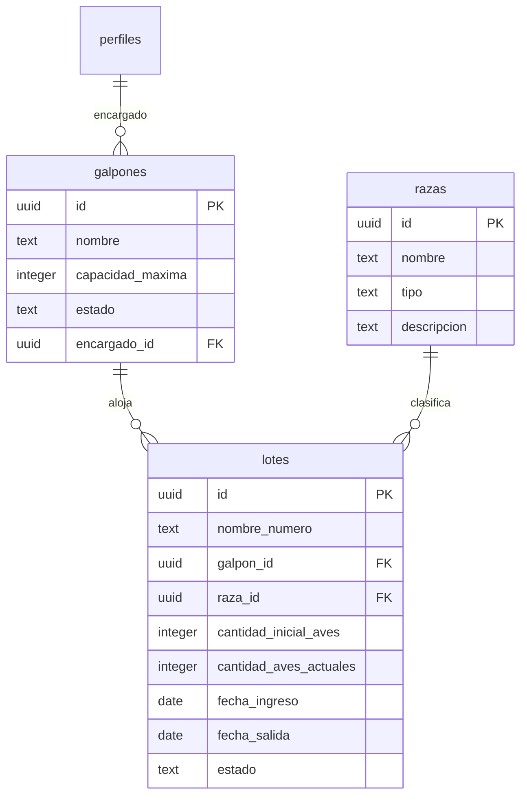
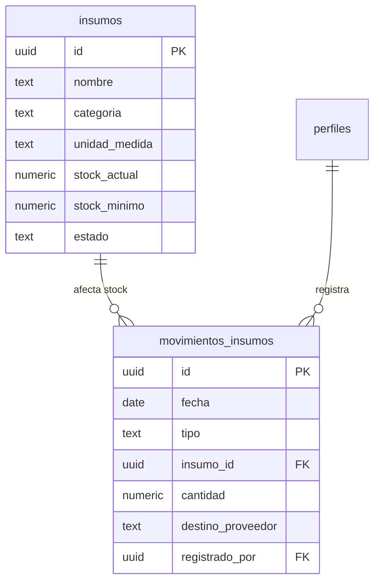
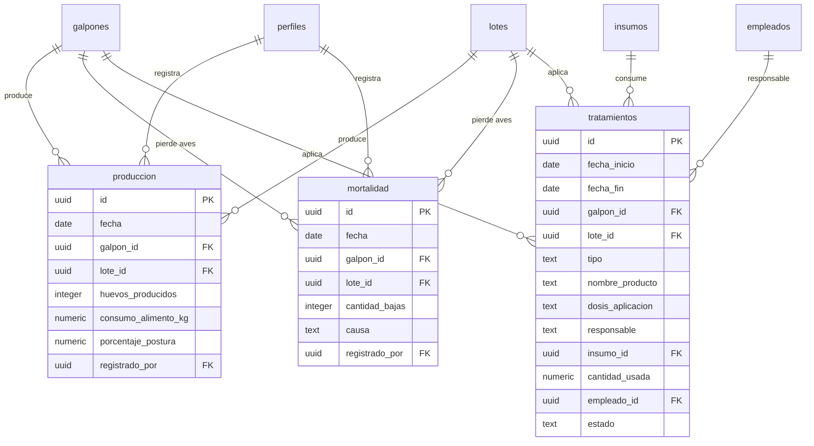
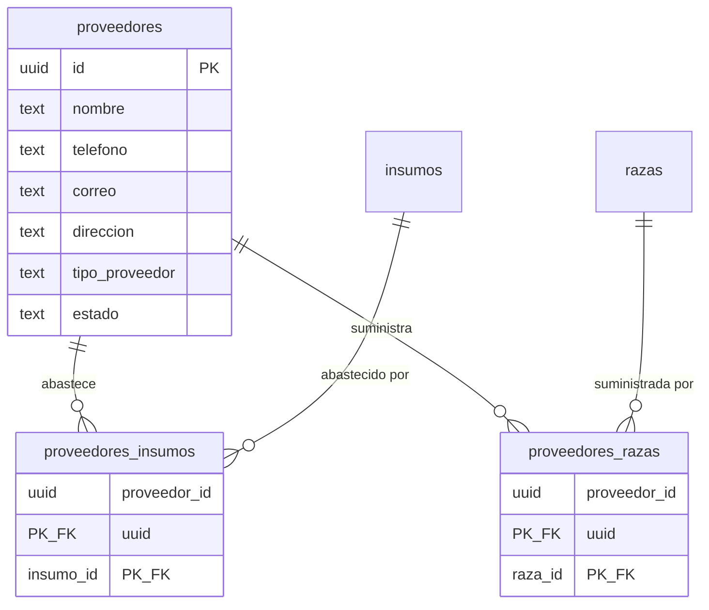
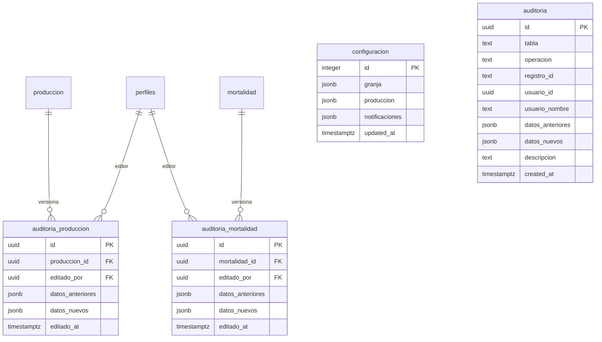

# MODELO RELACIONAL

**Proyecto:** Sistema de Gestión Avícola MC — plataforma web para la administración integral de granjas avícolas (galpones, lotes, insumos, producción, mortalidad y tratamientos).

**Objetivo:** Documentar la estructura de datos del sistema: el modelo relacional en PostgreSQL (Supabase) que guarda la información transaccional y el almacenamiento no relacional de objetos (Supabase Storage) donde se conservan los archivos binarios asociados al sistema.

---

## 1. Decisión de modelo de datos

La información que maneja una granja avícola es fuertemente estructurada y relacional: un galpón alberga lotes, cada lote pertenece a una raza y acumula registros diarios de producción, mortalidad y tratamientos; un insumo tiene stock que se afecta por movimientos de entrada y salida; un proveedor abastece insumos o razas específicos; una cuenta de usuario está asociada a un empleado y a un rol. Además, varias reglas de negocio deben garantizarse a nivel de datos (un único registro diario de producción por galpón, descuento automático de aves al registrar mortalidad, actualización automática de stock al registrar un movimiento, control de acceso por galpón según el rol del usuario).

Por eso el núcleo es un **modelo relacional en PostgreSQL 15+** (gestionado por Supabase), que asegura integridad referencial, restricciones `CHECK` y transacciones (Codd, 1970; Valderrey Sanz, 2013). Los archivos binarios (fotografías de avatar de los usuarios) no se almacenan en la base de datos sino en el **almacenamiento no relacional de objetos de Supabase Storage** (compatible con API S3). La base de datos solo guarda la URL pública del objeto; el archivo se entrega al navegador a través del CDN de Supabase, lo que mantiene la base liviana y centraliza las políticas de acceso.

**Tabla 1.** *Componentes de persistencia del Sistema Avícola MC*

| Componente | Tipo | Tecnología | Qué almacena |
|---|---|---|---|
| Base de datos transaccional | Relacional | PostgreSQL 15+ (Supabase) | 16 tablas: seguridad, empleados, operación avícola, inventario, producción, mortalidad, tratamientos, proveedores, configuración y auditoría |
| Autenticación | Relacional (esquema reservado) | Supabase Auth (`auth.users`) | Credenciales, email, UUID y metadatos de los usuarios registrados |
| Almacenamiento de objetos | No relacional (clave-objeto) | Supabase Storage (API S3) | Bucket `avatars`: imágenes de perfil de los usuarios |
| Sesión del navegador | No relacional (memoria/cookie) | JWT firmado por Supabase | Token de acceso con vigencia corta y renovación automática |

*Nota.* Elaboración propia.

---

## 2. Resumen del modelo relacional

**Tabla 2.** *Distribución de las tablas por módulo*

| Módulo | Tablas | Entidades | Llaves foráneas |
|---|---:|---|---:|
| 1. Seguridad, perfiles y empleados | 2 | `perfiles`, `empleados` | 2 |
| 2. Operación avícola: galpones y lotes | 3 | `galpones`, `lotes`, `razas` | 3 |
| 3. Inventario: insumos y movimientos | 2 | `insumos`, `movimientos_insumos` | 2 |
| 4. Producción, mortalidad y tratamientos | 3 | `produccion`, `mortalidad`, `tratamientos` | 11 |
| 5. Proveedores y catálogos | 3 | `proveedores`, `proveedores_insumos`, `proveedores_razas` | 4 |
| 6. Configuración y auditoría | 3 | `configuracion`, `auditoria`, `auditoria_produccion`, `auditoria_mortalidad` | 2 |

*Nota.* Elaboración propia a partir del esquema desplegado (`install.sql`) y las migraciones vigentes.

**Normalización.** Las tablas están en tercera forma normal: cada atributo depende solo de la llave primaria; los catálogos (`razas`, `proveedores`) y los dominios con valores finitos (`estado`, `tipo`, `categoria`, `rol`, `causa`) se controlan con restricciones `CHECK` para no repetir cadenas libres, y las relaciones muchos a muchos se resuelven con tablas intermedias (`proveedores_insumos`, `proveedores_razas`). Se desnormaliza a propósito en dos casos: `lotes.cantidad_aves_actuales` se actualiza por trigger al registrar mortalidad para evitar recalcular el saldo en cada consulta, y `insumos.stock_actual` se actualiza por trigger al registrar un movimiento para que el inventario esté siempre disponible sin agregar.

**Integridad.** Además de las llaves foráneas, el esquema define:

- **Restricciones `CHECK`** sobre dominios (`razas.tipo IN ('ponedoras','engorde')`, `insumos.categoria IN ('alimento','medicamento','vacuna','desinfectante','herramienta','otro')`, `mortalidad.causa IN ('enfermedad','accidente','causa_desconocida','depredador','calor_frio_extremo','otra')`, `tratamientos.tipo IN ('vacunacion','medicacion','desparasitacion','vitaminas','antibiotico','otro')`, `galpones.estado IN ('disponible','en_produccion','en_mantenimiento')`, `perfiles.rol IN ('administrador','encargado')`).
- **Restricciones `UNIQUE`** que implementan reglas de negocio: `UNIQUE (fecha, galpon_id)` en `produccion` (un único registro de producción diario por galpón) e índices únicos parciales en `empleados.telefono` y `empleados.documento_identidad` (no se repiten cuando están presentes).
- **Triggers de dominio** (`fn_mortalidad_update_lote`, `fn_movimiento_update_stock`, `fn_sync_galpon_estado`, `fn_create_perfil_on_signup`) y de **auditoría global** (`fn_audit_trigger`) que registra en `auditoria` todo `INSERT`, `UPDATE` y `DELETE` sobre las tablas operativas.
- **Row Level Security (RLS)** habilitado en todas las tablas, con políticas que exponen funciones `is_admin()` y `can_access_galpon(uuid)` para restringir el acceso de los encargados a los galpones que tienen asignados.

---

## 3. Diagramas entidad-relación por módulo

> *Notación pata de gallo (crow's foot). Los diagramas están descritos en sintaxis Mermaid ER y pueden renderizarse en GitHub, VS Code o cualquier visor compatible.*

### Figura 1. Módulo 1 — Seguridad, perfiles y empleados

```mermaid
erDiagram
  auth_users ||--|| perfiles : "1:1 (id)"
  empleados  ||--o{ perfiles : "0..N vinculaciones"

  auth_users {
    uuid id PK
    text email
    jsonb raw_user_meta_data
  }
  perfiles {
    uuid id PK_FK
    text nombre_completo
    text email
    text rol
    text estado
    uuid empleado_id FK
    timestamptz ultimo_acceso
    text avatar_url
  }
  empleados {
    uuid id PK
    text nombre_completo
    text documento_identidad
    text cargo
    text telefono
    date fecha_ingreso
    text estado
  }
```

### Figura 2. Módulo 2 — Operación avícola: galpones y lotes



### Figura 3. Módulo 3 — Inventario: insumos y movimientos



### Figura 4. Módulo 4 — Producción, mortalidad y tratamientos



### Figura 5. Módulo 5 — Proveedores y catálogos



### Figura 6. Módulo 6 — Configuración y auditoría



*Nota.* Los diagramas se elaboraron a partir del esquema de la base de datos definido en `install.sql`. Notación pata de gallo.

---

## 4. Diccionario de tablas

### Módulo 1. Seguridad, perfiles y empleados

| Tabla | Descripción | PK | Llaves foráneas |
|---|---|---|---|
| `perfiles` | Perfil de aplicación de cada usuario; extiende `auth.users` con rol, estado, nombre completo y empleado vinculado. Se crea automáticamente al registrar un usuario mediante el trigger `fn_create_perfil_on_signup`. | `id` | `id` → `auth.users.id`; `empleado_id` → `empleados.id` |
| `empleados` | Catálogo del personal de la granja (nombre, documento, cargo, teléfono, fecha de ingreso). Puede existir sin tener cuenta de usuario asociada. | `id` | — |

### Módulo 2. Operación avícola: galpones y lotes

| Tabla | Descripción | PK | Llaves foráneas |
|---|---|---|---|
| `galpones` | Instalaciones físicas donde se alojan las aves. Cada galpón tiene capacidad máxima, estado operativo y un encargado responsable. | `id` | `encargado_id` → `perfiles.id` |
| `lotes` | Grupos de aves que ingresan al galpón en una fecha determinada; conserva el saldo actual de aves y el estado del ciclo productivo. El trigger `fn_sync_galpon_estado` sincroniza el estado del galpón con el del lote activo. | `id` | `galpon_id` → `galpones.id`; `raza_id` → `razas.id` |
| `razas` | Catálogo de razas avícolas (ponedoras o engorde) con descripción. | `id` | — |

### Módulo 3. Inventario: insumos y movimientos

| Tabla | Descripción | PK | Llaves foráneas |
|---|---|---|---|
| `insumos` | Catálogo de insumos (alimento, medicamento, vacuna, desinfectante, herramienta u otro) con unidad de medida, stock actual y stock mínimo para generar alertas. | `id` | — |
| `movimientos_insumos` | Historial de entradas y salidas de insumos con destino o proveedor. El trigger `fn_movimiento_update_stock` actualiza automáticamente `insumos.stock_actual`. | `id` | `insumo_id` → `insumos.id`; `registrado_por` → `perfiles.id` |

### Módulo 4. Producción, mortalidad y tratamientos

| Tabla | Descripción | PK | Llaves foráneas |
|---|---|---|---|
| `produccion` | Registro diario de huevos producidos y consumo de alimento por galpón; `UNIQUE (fecha, galpon_id)` evita duplicados. | `id` | `galpon_id` → `galpones.id`; `lote_id` → `lotes.id`; `registrado_por` → `perfiles.id` |
| `mortalidad` | Registro de bajas de aves con causa tipificada. El trigger `fn_mortalidad_update_lote` descuenta las bajas de `lotes.cantidad_aves_actuales`. | `id` | `galpon_id` → `galpones.id`; `lote_id` → `lotes.id`; `registrado_por` → `perfiles.id` |
| `tratamientos` | Vacunaciones, medicaciones, desparasitaciones, aplicaciones vitamínicas y antibióticas con rango de fechas, dosis, responsable, insumo consumido y empleado ejecutor. | `id` | `galpon_id` → `galpones.id`; `lote_id` → `lotes.id`; `insumo_id` → `insumos.id`; `empleado_id` → `empleados.id` |

### Módulo 5. Proveedores y catálogos

| Tabla | Descripción | PK | Llaves foráneas |
|---|---|---|---|
| `proveedores` | Proveedores de insumos o razas con datos de contacto; `tipo_proveedor` distingue si abastece insumos, razas, ambos u otro rubro. | `id` | — |
| `proveedores_insumos` | Tabla intermedia (muchos a muchos) entre `proveedores` e `insumos`. | `(proveedor_id, insumo_id)` | `proveedor_id` → `proveedores.id`; `insumo_id` → `insumos.id` |
| `proveedores_razas` | Tabla intermedia (muchos a muchos) entre `proveedores` y `razas`. | `(proveedor_id, raza_id)` | `proveedor_id` → `proveedores.id`; `raza_id` → `razas.id` |

### Módulo 6. Configuración y auditoría

| Tabla | Descripción | PK | Llaves foráneas |
|---|---|---|---|
| `configuracion` | Configuración global del sistema en una única fila (`id = 1`): datos de la granja, umbrales de producción y preferencias de notificación. Se almacena en columnas JSONB para flexibilidad. | `id` | — |
| `auditoria` | Auditoría global de operaciones (`INSERT`, `UPDATE`, `DELETE`) sobre las tablas operativas; registra valor anterior y nuevo en JSONB. Alimentada por el trigger `fn_audit_trigger`. | `id` | — |
| `auditoria_produccion` | Auditoría específica de ediciones a `produccion` con snapshot anterior y nuevo en JSONB. | `id` | `produccion_id` → `produccion.id`; `editado_por` → `perfiles.id` |
| `auditoria_mortalidad` | Auditoría específica de ediciones a `mortalidad` con snapshot anterior y nuevo en JSONB. | `id` | `mortalidad_id` → `mortalidad.id`; `editado_por` → `perfiles.id` |

---

## 5. Almacenamiento no relacional (Supabase Storage)

**Tabla 3.** *Buckets de almacenamiento de objetos*

| Bucket | Acceso | Contenido | Ruta típica del objeto |
|---|---|---|---|
| `avatars` | Público (lectura por URL del CDN) | Imágenes de perfil de los usuarios | `avatars/{uuid}.{ext}` |

*Nota.* La URL pública del objeto se guarda en la columna `perfiles.avatar_url`. La escritura y eliminación requieren una sesión autenticada; la lectura es pública para que el navegador pueda cargar la imagen directamente desde el CDN de Supabase sin firmar URLs.

---

## Anexo A. Diccionario de columnas

### `perfiles` — Perfil de aplicación de cada usuario; extiende `auth.users`

| Columna | Tipo | Nulo | Llave |
|---|---|---|---|
| `id` | UUID | No | PK, FK → `auth.users.id` (ON DELETE CASCADE) |
| `nombre_completo` | TEXT | No | |
| `email` | TEXT | Sí | |
| `rol` | TEXT | No | CHECK IN (`administrador`, `encargado`) |
| `estado` | TEXT | No | CHECK IN (`activo`, `inactivo`); default `activo` |
| `empleado_id` | UUID | Sí | FK → `empleados.id` |
| `ultimo_acceso` | TIMESTAMPTZ | Sí | |
| `avatar_url` | TEXT | Sí | |
| `created_at` | TIMESTAMPTZ | No | default `NOW()` |

### `empleados` — Catálogo del personal

| Columna | Tipo | Nulo | Llave |
|---|---|---|---|
| `id` | UUID | No | PK |
| `nombre_completo` | TEXT | No | |
| `documento_identidad` | TEXT | Sí | UQ parcial (cuando no es nulo ni vacío) |
| `cargo` | TEXT | Sí | |
| `telefono` | TEXT | Sí | UQ parcial (cuando no es nulo ni vacío) |
| `fecha_ingreso` | DATE | Sí | |
| `estado` | TEXT | No | CHECK IN (`activo`, `inactivo`); default `activo` |
| `notas` | TEXT | Sí | |
| `created_at` | TIMESTAMPTZ | No | default `NOW()` |

### `galpones` — Instalaciones físicas de alojamiento

| Columna | Tipo | Nulo | Llave |
|---|---|---|---|
| `id` | UUID | No | PK |
| `nombre` | TEXT | No | |
| `capacidad_maxima` | INTEGER | No | |
| `descripcion` | TEXT | Sí | |
| `estado` | TEXT | No | CHECK IN (`disponible`, `en_produccion`, `en_mantenimiento`); default `disponible` |
| `encargado_id` | UUID | Sí | FK → `perfiles.id` |
| `created_at` | TIMESTAMPTZ | No | default `NOW()` |
| `updated_at` | TIMESTAMPTZ | No | default `NOW()` (trigger `trg_galpones_updated_at`) |

### `lotes` — Grupos de aves alojadas en un galpón

| Columna | Tipo | Nulo | Llave |
|---|---|---|---|
| `id` | UUID | No | PK |
| `nombre_numero` | TEXT | No | |
| `galpon_id` | UUID | No | FK → `galpones.id` (ON DELETE CASCADE) |
| `raza_id` | UUID | Sí | FK → `razas.id` |
| `cantidad_inicial_aves` | INTEGER | No | |
| `cantidad_aves_actuales` | INTEGER | No | |
| `fecha_ingreso` | DATE | No | |
| `fecha_salida` | DATE | Sí | |
| `estado` | TEXT | No | CHECK IN (`activo`, `finalizado`); default `activo` |
| `notas` | TEXT | Sí | |
| `created_at` | TIMESTAMPTZ | No | default `NOW()` |

### `razas` — Catálogo de razas avícolas

| Columna | Tipo | Nulo | Llave |
|---|---|---|---|
| `id` | UUID | No | PK |
| `nombre` | TEXT | No | |
| `tipo` | TEXT | No | CHECK IN (`ponedoras`, `engorde`) |
| `descripcion` | TEXT | Sí | |
| `created_at` | TIMESTAMPTZ | No | default `NOW()` |

### `insumos` — Catálogo de insumos con stock

| Columna | Tipo | Nulo | Llave |
|---|---|---|---|
| `id` | UUID | No | PK |
| `nombre` | TEXT | No | |
| `categoria` | TEXT | No | CHECK IN (`alimento`, `medicamento`, `vacuna`, `desinfectante`, `herramienta`, `otro`) |
| `unidad_medida` | TEXT | No | |
| `stock_actual` | DECIMAL(10,2) | Sí | default `0` |
| `stock_minimo` | DECIMAL(10,2) | Sí | default `0` |
| `estado` | TEXT | No | CHECK IN (`activo`, `inactivo`); default `activo` |
| `created_at` | TIMESTAMPTZ | No | default `NOW()` |

### `movimientos_insumos` — Entradas y salidas de inventario

| Columna | Tipo | Nulo | Llave |
|---|---|---|---|
| `id` | UUID | No | PK |
| `fecha` | DATE | No | |
| `tipo` | TEXT | No | CHECK IN (`entrada`, `salida`) |
| `insumo_id` | UUID | No | FK → `insumos.id` |
| `cantidad` | DECIMAL(10,2) | No | |
| `destino_proveedor` | TEXT | Sí | |
| `observaciones` | TEXT | Sí | |
| `registrado_por` | UUID | Sí | FK → `perfiles.id` |
| `created_at` | TIMESTAMPTZ | No | default `NOW()` |

### `produccion` — Registro diario de producción por galpón

| Columna | Tipo | Nulo | Llave |
|---|---|---|---|
| `id` | UUID | No | PK |
| `fecha` | DATE | No | UQ (`fecha`, `galpon_id`) |
| `galpon_id` | UUID | No | FK → `galpones.id`; UQ (`fecha`, `galpon_id`) |
| `lote_id` | UUID | No | FK → `lotes.id` |
| `huevos_producidos` | INTEGER | No | |
| `consumo_alimento_kg` | DECIMAL(10,2) | No | |
| `porcentaje_postura` | DECIMAL(5,2) | Sí | |
| `observaciones` | TEXT | Sí | |
| `registrado_por` | UUID | Sí | FK → `perfiles.id` |
| `created_at` | TIMESTAMPTZ | No | default `NOW()` |

### `mortalidad` — Registro de bajas de aves

| Columna | Tipo | Nulo | Llave |
|---|---|---|---|
| `id` | UUID | No | PK |
| `fecha` | DATE | No | |
| `galpon_id` | UUID | No | FK → `galpones.id` |
| `lote_id` | UUID | No | FK → `lotes.id` |
| `cantidad_bajas` | INTEGER | No | |
| `causa` | TEXT | No | CHECK IN (`enfermedad`, `accidente`, `causa_desconocida`, `depredador`, `calor_frio_extremo`, `otra`) |
| `causa_otra` | TEXT | Sí | |
| `observaciones` | TEXT | Sí | |
| `registrado_por` | UUID | Sí | FK → `perfiles.id` |
| `created_at` | TIMESTAMPTZ | No | default `NOW()` |

### `tratamientos` — Vacunaciones, medicaciones y aplicaciones sanitarias

| Columna | Tipo | Nulo | Llave |
|---|---|---|---|
| `id` | UUID | No | PK |
| `fecha_inicio` | DATE | No | |
| `fecha_fin` | DATE | Sí | |
| `galpon_id` | UUID | No | FK → `galpones.id` |
| `lote_id` | UUID | No | FK → `lotes.id` |
| `tipo` | TEXT | No | CHECK IN (`vacunacion`, `medicacion`, `desparasitacion`, `vitaminas`, `antibiotico`, `otro`) |
| `nombre_producto` | TEXT | No | |
| `dosis_aplicacion` | TEXT | No | |
| `responsable` | TEXT | No | |
| `estado` | TEXT | No | CHECK IN (`activo`, `finalizado`); default `activo` |
| `observaciones` | TEXT | Sí | |
| `insumo_id` | UUID | Sí | FK → `insumos.id` |
| `cantidad_usada` | DECIMAL(10,2) | Sí | |
| `empleado_id` | UUID | Sí | FK → `empleados.id` (ON DELETE SET NULL) |
| `created_at` | TIMESTAMPTZ | No | default `NOW()` |
| `updated_at` | TIMESTAMPTZ | No | default `NOW()` (trigger `trg_tratamientos_updated_at`) |

### `proveedores` — Catálogo de proveedores externos

| Columna | Tipo | Nulo | Llave |
|---|---|---|---|
| `id` | UUID | No | PK |
| `nombre` | TEXT | No | |
| `telefono` | TEXT | No | |
| `correo` | TEXT | Sí | |
| `direccion` | TEXT | Sí | |
| `tipo_proveedor` | TEXT | No | CHECK IN (`insumos`, `razas`, `ambos`, `otro`) |
| `estado` | TEXT | No | CHECK IN (`activo`, `inactivo`); default `activo` |
| `notas` | TEXT | Sí | |
| `created_at` | TIMESTAMPTZ | No | default `NOW()` |

### `proveedores_insumos` — Tabla intermedia proveedor ↔ insumo

| Columna | Tipo | Nulo | Llave |
|---|---|---|---|
| `proveedor_id` | UUID | No | PK compuesta; FK → `proveedores.id` (ON DELETE CASCADE) |
| `insumo_id` | UUID | No | PK compuesta; FK → `insumos.id` (ON DELETE CASCADE) |

### `proveedores_razas` — Tabla intermedia proveedor ↔ raza

| Columna | Tipo | Nulo | Llave |
|---|---|---|---|
| `proveedor_id` | UUID | No | PK compuesta; FK → `proveedores.id` (ON DELETE CASCADE) |
| `raza_id` | UUID | No | PK compuesta; FK → `razas.id` (ON DELETE CASCADE) |

### `configuracion` — Configuración global del sistema

| Columna | Tipo | Nulo | Llave |
|---|---|---|---|
| `id` | INTEGER | No | PK (siempre `1`) |
| `granja` | JSONB | Sí | nombre, NIT, dirección, ciudad, teléfono, email |
| `produccion` | JSONB | Sí | umbrales de postura, alerta de mortalidad, peso del huevo, peso del saco |
| `notificaciones` | JSONB | Sí | banderas de notificaciones habilitadas por tipo |
| `updated_at` | TIMESTAMPTZ | No | default `NOW()` |

### `auditoria` — Auditoría global de operaciones

| Columna | Tipo | Nulo | Llave |
|---|---|---|---|
| `id` | UUID | No | PK |
| `tabla` | TEXT | No | nombre de la tabla afectada |
| `operacion` | TEXT | No | `INSERT`, `UPDATE` o `DELETE` |
| `registro_id` | TEXT | Sí | ID del registro afectado (texto para admitir cualquier tipo de PK) |
| `usuario_id` | UUID | Sí | `auth.uid()` al momento de la operación |
| `usuario_nombre` | TEXT | Sí | `perfiles.nombre_completo` resuelto en el trigger |
| `datos_anteriores` | JSONB | Sí | snapshot del registro antes del cambio |
| `datos_nuevos` | JSONB | Sí | snapshot del registro después del cambio |
| `descripcion` | TEXT | Sí | |
| `created_at` | TIMESTAMPTZ | No | default `NOW()` |

### `auditoria_produccion` — Auditoría específica de producción

| Columna | Tipo | Nulo | Llave |
|---|---|---|---|
| `id` | UUID | No | PK |
| `produccion_id` | UUID | No | FK → `produccion.id` (ON DELETE CASCADE) |
| `editado_por` | UUID | No | FK → `perfiles.id` |
| `datos_anteriores` | JSONB | No | |
| `datos_nuevos` | JSONB | No | |
| `editado_at` | TIMESTAMPTZ | No | default `NOW()` |

### `auditoria_mortalidad` — Auditoría específica de mortalidad

| Columna | Tipo | Nulo | Llave |
|---|---|---|---|
| `id` | UUID | No | PK |
| `mortalidad_id` | UUID | No | FK → `mortalidad.id` (ON DELETE CASCADE) |
| `editado_por` | UUID | No | FK → `perfiles.id` |
| `datos_anteriores` | JSONB | No | |
| `datos_nuevos` | JSONB | No | |
| `editado_at` | TIMESTAMPTZ | No | default `NOW()` |

---

## Referencias

- Codd, E. F. (1970). A relational model of data for large shared data banks. *Communications of the ACM, 13*(6), 377–387. https://doi.org/10.1145/362384.362685
- Valderrey Sanz, P. (2013). *Administración de sistemas gestores de bases de datos*. Ecoe Ediciones.
- Supabase Inc. (2024). *PostgreSQL database and Row Level Security documentation*. https://supabase.com/docs
